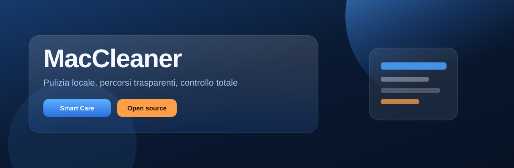
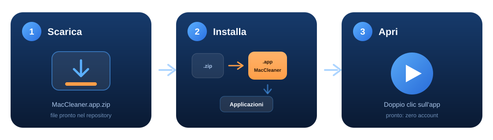

<p align="center">
  
</p>

<h1 align="center">MacCleaner</h1>

<p align="center">
  <strong>Riprendi spazio sul Mac.</strong><br/>
  Pulitore <strong>open-source</strong>, nativo SwiftUI: Smart Care, disinstallazione, prestazioni e manutenzione.<br/>
  <strong>Zero telemetria. Zero account. Zero cloud.</strong> Tutto resta sul tuo Mac.
</p>

<p align="center">
  
  
  
</p>

<p align="center">
  
  
  
  
  
</p>

<p align="center">
  <a href="releases/MacCleaner.app.zip"><strong>Scarica MacCleaner.app.zip</strong></a> ·
  <a href="#fiducia-verificabile">Privacy</a> ·
  <a href="#funzionalità">Funzionalità</a> ·
  <a href="#installazione">Installazione</a> ·
  <a href="#sicurezza-e-privilegi">Sicurezza</a>
</p>

---

## Fiducia verificabile

Un cleaner per Mac può vedere file sensibili e chiedere privilegi elevati. Merita trasparenza, non slogan. Questo è il contratto di MacCleaner — e puoi controllarlo nel codice sorgente:

| Impegno | Cosa significa |
|---|---|
| **Nessuna telemetria, mai** | Niente analytics, crash reporter di terze parti, “statistiche anonime”, account o phone-home. L’app **non sa chi sei**. |
| **Nessuna rete verso di noi** | Scansioni e pulizie funzionano **offline**. Non carichiamo percorsi, elenchi file o dati cancellati. |
| **Niente urgenza finta** | Nessun allarme rosso del tipo “il Mac è a rischio”. Mostriamo dimensioni e percorsi neutri: decidi tu. |
| **Selezione esplicita** | Niente “pulisci tutto” cieco. Vedi i path, spunti cosa liberare, puoi **Stop** durante scansione/pulizia. |
| **Cestino per le pulizie utente** | Gli item utente selezionati vanno nel **Cestino** di macOS (`trashItem`), non in un delete silenzioso nascosto. |
| **Admin solo su allowlist** | Cache/log di sistema e simili passano da un bridge con password e percorsi **consentiti esplicitamente**. |
| **Open source (MIT)** | Codice leggibile, forkabile, auditabile. Se un giorno aggiungesse telemetria o paywall sulle funzioni base, tradirebbe questo contratto. |

### Cosa MacCleaner **non** fa

- Non raccoglie telemetria, crash report o usage analytics  
- Non richiede account, login o abbonamento  
- Non carica su server esterni i percorsi scansionati o i file eliminati  
- Non si presenta come antivirus / scanner malware  
- Non promette “boost RAM” o magie sullo spazio purgeable APFS  

---

## Indice

1. [Fiducia verificabile](#fiducia-verificabile)  
2. [Perché MacCleaner](#perché-maccleaner)  
3. [Requisiti](#requisiti)  
4. [Funzionalità](#funzionalità)  
5. [Interfaccia e lingua](#interfaccia-e-lingua)  
6. [Installazione](#installazione)  
7. [Sviluppo e CLI](#sviluppo-e-cli)  
8. [Sicurezza e privilegi](#sicurezza-e-privilegi)  
9. [Roadmap](#roadmap)  
10. [Licenza](#licenza)  

---

## Perché MacCleaner

Molti cleaner commerciali nascondono la logica dietro abbonamenti, telemetria e messaggi alarmisti. MacCleaner è l’opposto:

- **Installazione una tantum** — niente trial, niente account  
- **Zero telemetria** — non chiama casa; non sa che esisti  
- **MIT open source** — leggi, verifica, modifica  
- **Scansioni oneste** — cache, leftover, DerivedData, log: fatti misurabili, non paura  
- **Disinstallazioni reali** — residui in Library (prefs, cache, container, agent…) con selezione esplicita  

MacCleaner è **locale e trasparente**: ogni elemento recuperabile mostra il percorso sul disco; le operazioni di sistema usano un bridge admin con **allowlist**.

| Principio | In pratica |
|---|---|
| Locale | Solo filesystem; nessuna telemetria di prodotto |
| Trasparente | Dimensioni, percorsi e categorie sempre visibili |
| Selettivo | Item per item, non “pulisci tutto” cieco |
| Interrompibile | **Stop** durante Smart Care o pulizia |
| Privato | Nessun analytics, nessun crash phone-home |
| Bilingue | Italiano e inglese (sistema o scelta in Impostazioni) |

---

## Requisiti

- **macOS 14** (Sonoma) o successivo  
- Binario universale (Apple Silicon + Intel) in [`releases/MacCleaner.app.zip`](releases/MacCleaner.app.zip)  
- Xcode / Swift solo se vuoi compilare dal sorgente  

---

## Funzionalità

### Smart Care

Scansione multi-categoria dello spazio recuperabile, con te al comando.

- **Avvia Smart Care** con avanzamento per categoria  
- Metriche: recuperabile, scansionato, stato  
- Moduli cliccabili → **dettaglio** categoria  
- **Pulisci selezionati** → solo ciò che hai spuntato, nel Cestino  
- **Stop** durante scansione o pulizia  

#### Categorie scansionate

| Categoria | Cosa misura | Note |
|---|---|---|
| Cache utente | `~/Library/Caches` | Pulibile |
| Log utente | `~/Library/Logs` | Pulibile |
| Cestino | `~/.Trash` | Pulibile |
| Xcode DerivedData | `~/Library/Developer/Xcode/DerivedData` | Pulibile |
| Archivi Xcode | `~/Library/Developer/Xcode/Archives` | Pulibile |
| Cache sviluppatore | npm, Homebrew, pip, Gradle, Yarn, pnpm, Cargo… | Pulibile |
| Download vecchi | Download &gt; 30 giorni | Pulibile |
| Immagini disco | `*.dmg` / `*.iso` in Download | Pulibile |
| Cache browser | Safari / Chrome / Firefox / Edge | Pulibile |
| Cartelle grandi | Top cartelle Home | Solo lettura |
| Residui app | Prefs, cache, container orfani | Pulibile |
| Launch Agent non validi | Agent utente con binario mancante | Pulibile |
| Cache di sistema | `/Library/Caches` | Admin + allowlist |
| Log di sistema | `/Library/Logs`, `/var/log` | Admin + allowlist |
| Agent di sistema non validi | `/Library/LaunchAgents` | Admin + allowlist |

---

### Applicazioni

Disinstallazione consapevole con residui correlati.

- Elenco app utente (ricerca nome / bundle ID)  
- Dimensione bundle + residui  
- Leftover: Preferences, Caches, Application Support, Logs, Saved State, Cookies, Containers, Group Containers, Launch Agents, Crash Reporter  
- Toggle “Includi il bundle dell’app”  
- Pulizia **residui orfani**  
- App di sistema protette: uninstall disabilitato  

---

### Prestazioni

- Memoria, CPU, disco libero  
- Top processi per memoria  
- Launch Agent (rimozione solo dominio utente)  
- Manutenzione: DNS *(admin)*, Mail VACUUM, snapshot APFS *(admin)*, Launch Services  

---

### Helper privilegiato

- Bridge admin (prompt password)  
- Rescan cache/log/agent di sistema  
- DNS flush e thin snapshot  
- Solo percorsi in **allowlist**  
- Scaffold futuro `SMAppService` → `docs/PRIVILEGED_HELPER.md`  

---

### Space Lens

Barre delle categorie già scansionate: dove va lo spazio dopo Smart Care.

---

### Aggiornamenti

Sezione dedicata nell’app: confronta la versione locale con [`releases/version.json`](releases/version.json) sul repo, scarica [`MacCleaner.app.zip`](releases/MacCleaner.app.zip) e installa in `~/Applications`, poi riavvia. Il controllo rete va solo verso GitHub e solo quando apri la sezione o premi “Controlla”.

### Menu bar (one-click)

Pannello glass (non menu classico): stato Mac, disco/RAM/batteria/CPU, rete, attività, consiglio Smart Care, Apri / Impostazioni / **Esci**. Una sola finestra principale — niente istanze duplicate.

---

### Impostazioni

Lingua (Sistema / EN / IT), menu bar, Dock, avvio all’accesso, installazione in `~/Applications`, **Esci**.

---

## Interfaccia e lingua

Tema **dark blue-glass**. Stringhe in `en.lproj` / `it.lproj`.

| Scorciatoia | Azione |
|---|---|
| ⌘R | Avvia Smart Care |
| ⌘K | Pulisci selezionati |
| ⌘Q | Esci |
| ⇧⌘U | Aggiorna applicazioni |
| ⇧⌘P | Aggiorna prestazioni |

---

## Installazione

Non serve saper programmare. Scarichi un file, lo metti in Applicazioni e apri MacCleaner — come molte altre app per Mac.

<p align="center">
  <a href="releases/MacCleaner.app.zip">
    
  </a>
</p>

<p align="center">
  
</p>

### In 3 passi

| | Cosa fare | Dettaglio |
|:---:|---|---|
| **1** | **Scarica** | Clicca **[MacCleaner.app.zip](releases/MacCleaner.app.zip)** e salva il file (è già incluso in questo progetto). |
| **2** | **Installa** | Apri lo zip con un doppio clic. Trascina **MacCleaner** nella cartella **Applicazioni** (Finder → Preferiti → Applicazioni). |
| **3** | **Apri** | Da **Applicazioni**: **tasto destro** su MacCleaner → **Apri** (non il doppio clic al primo avvio). |

Funziona su Mac con chip Apple (M1/M2/M3/…) e su Mac Intel.

<details open>
<summary><strong>Se compare “MacCleaner.app non è stata aperta” / malware</strong></summary>

<br/>

È **normale**: l’app è open source e **non è ancora notarizzata** da Apple (serve un account Developer a pagamento). Non significa che sia pericolosa — macOS blocca le app scaricate senza firma ufficiale.

**Metodo consigliato**

1. Clicca **Fine** (non “Sposta nel Cestino”)  
2. Apri **Finder** → cartella dove hai messo l’app (**Applicazioni** o Download)  
3. **Tasto destro** (o Control-clic) su **MacCleaner** → **Apri**  
4. Nella nuova finestra conferma di nuovo **Apri**

**Se non vedi “Apri”**

1. **Impostazioni di Sistema** → **Privacy e sicurezza**  
2. Scorri fino al messaggio su MacCleaner → **Apri comunque**

**Da Terminale** (dopo aver messo l’app in Applicazioni):

```bash
xattr -dr com.apple.quarantine ~/Applications/MacCleaner.app
open ~/Applications/MacCleaner.app
```

Dalla volta successiva basta il doppio clic.

</details>

<details>
<summary><strong>Come disinstallare</strong></summary>

<br/>

Trascina **MacCleaner** dal Finder (cartella Applicazioni) nel **Cestino**, poi svuota il Cestino se vuoi.

</details>

<details>
<summary><strong>Opzioni per chi sviluppa</strong> (facoltative)</summary>

<br/>

**Da Terminale** (senza clonare il progetto):

```bash
curl -L -o MacCleaner.app.zip \
  https://github.com/mponzo/MacCleaner/raw/main/releases/MacCleaner.app.zip
unzip -o MacCleaner.app.zip
mkdir -p ~/Applications
mv -f MacCleaner.app ~/Applications/
xattr -dr com.apple.quarantine ~/Applications/MacCleaner.app 2>/dev/null || true
open ~/Applications/MacCleaner.app
```

**Dal sorgente** (serve Xcode / Swift):

```bash
./Scripts/install.sh       # compila e installa in ~/Applications
./Scripts/package-app.sh   # crea dist/MacCleaner.app + aggiorna lo zip
./Scripts/uninstall.sh
```

Bundle id: `com.maccleaner.app` · target SPM: `OpenCleanMyMac`.

</details>

---


## Sito web (GitHub Pages)

Landing Nuxt 3 nella root del repo (`pages/`, `nuxt.config.ts`). Il workflow [`.github/workflows/nuxtjs.yml`](.github/workflows/nuxtjs.yml) esegue `npm ci` + `nuxt generate` e pubblica `.output/public` su **GitHub Pages**.

```bash
npm install
npm run dev          # locale
npm run generate     # export statico → .output/public
```

**Prima del deploy** (una tantum): repository → **Settings → Pages → Build and deployment → Source: GitHub Actions**. Senza questo passo l’Action fallisce con *Get Pages site failed*. URL tipico: `https://mponzo.github.io/MacCleaner/`.

---

## Sviluppo e CLI

```bash
cd OpenCleanMyMac
swift build
swift run
```

Headless (senza UI, utili per audit locali):

```bash
swift run OpenCleanMyMac -- --scan-once
swift run OpenCleanMyMac -- --apps-once
swift run OpenCleanMyMac -- --perf-once
swift run OpenCleanMyMac -- --priv-once
```

```text
OpenCleanMyMac/Sources/OpenCleanMyMac/
  App/  Core/  Features/  Localization/  Resources/  UI/
Scripts/   docs/
```

---

## Sicurezza e privilegi

### Privacy by design

| Domanda | Risposta |
|---|---|
| Invia dati a internet? | **No** per scan/clean (lavoro offline) |
| Telemetria / analytics? | **No** |
| Crash reporter remoto? | **No** |
| Account obbligatorio? | **No** |
| Codice ispezionabile? | **Sì** (MIT) |

### Comportamento distruttivo

- Pulizie utente → **Cestino** macOS  
- Sistema → bridge admin + **allowlist**  
- Selezione e conferma implicita (spunte) prima della pulizia  
- **Stop** interrompe la task in corso  
- Non è un antivirus  

Se trovi un problema di sicurezza, segnalalo in privato (non in issue pubbliche con PoC).

---

## Roadmap

- Daemon privilegiato firmato (`SMAppService`) al posto dei prompt osascript  
- Più copertura scanner e raffinamento UI  
- Lingue oltre IT/EN  

---

## Licenza

**MIT.** Usa, modifica, redistribuisci. L’unica richiesta tipica della licenza MIT è mantenere l’avviso di copyright.

> Se MacCleaner ti ha liberato spazio **senza** vendere i tuoi dati, è esattamente lo scopo del progetto.
